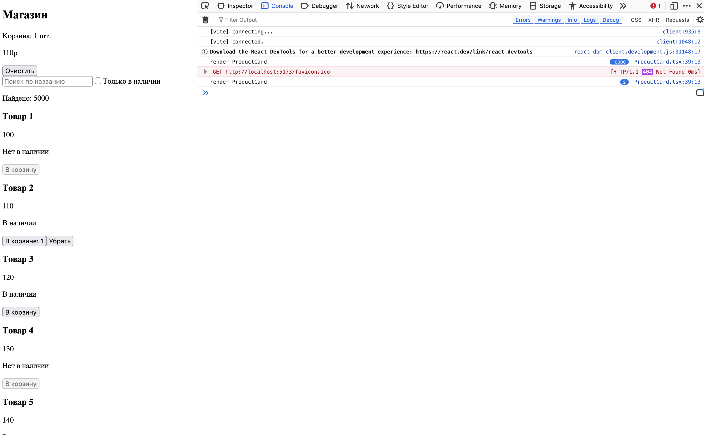

Отрисовок вдвое больше, так как используется StrictMode:

useCallback нужен для мемоизации, так как при каждом рендере создаются новые функции, что означает для мемо, что они поменялись, а это не так. useCallback возвращает одну и ту же ссылку на функцию, что предотвращает лишние перерисовки.